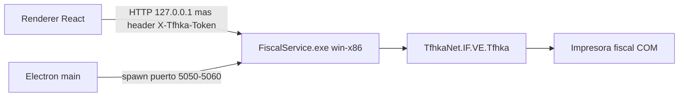

# Servicio fiscal

Crema Stereo POS habla con la impresora fiscal The Factory HKA a través de un proceso local .NET. La interfaz de la app, por ahora, es solo la página de inicio. El servicio ya arranca y se apaga con Electron, y el renderer tiene las funciones que arman y envían comandos.

## Cómo se reparte el trabajo

- Electron elige un puerto libre entre **5050 y 5060**, genera un token y lanza `FiscalService.exe` con `--port`, `--token` y `--parent-pid`.
- Todas las rutas, salvo `GET /health`, exigen el header `X-Tfhka-Token`.
- Los comandos fiscales no pasan por IPC. El renderer llama HTTP con `callSdk` (`src/renderer/src/fiscal/api/client.ts`).
- IPC solo cubre el ciclo de vida: `service:getInfo`, `service:restart`, `service:forceRestart`, logs, diálogo de archivo y ruta de samples. Eso queda en `window.fiscal`.
- El proceso .NET es **win-x86** porque `TfhkaNet.dll` 1.7.6.2 es de 32 bits. Una sola cola en un hilo STA serializa las llamadas a la impresora.
- Un watchdog dentro del servicio termina el proceso si el PID de Electron desaparece.

## Documentos

- [servicio.md](servicio.md) — arranque, salud, reinicio, apagado y publicación.
- [api-http.md](api-http.md) — envelope JSON y mapa de endpoints.
- [comandos-documento.md](comandos-documento.md) — cómo se arma una factura, una nota de crédito y una nota de débito.
- [diferencias-dll.md](diferencias-dll.md) — lo que la DLL 1.7.6.2 no coincide con el manual 1.4.
- [manual/](manual/00-portada-e-indice.md) — transcripción del manual del proveedor (MLJ-CINT-01, versión 1.4, 02/04/2022).
