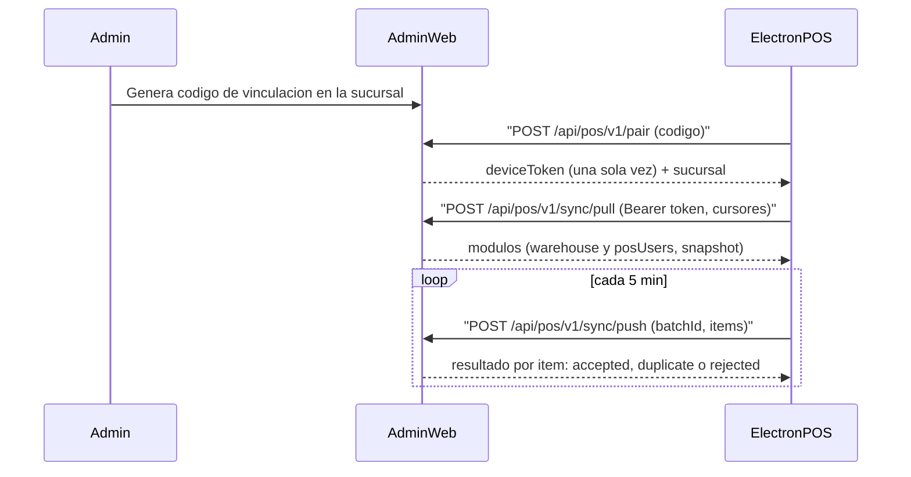

# Sincronización POS

Esta carpeta documenta cómo la aplicación administrativa (esta app web) se
comunica con las aplicaciones POS (Electron, offline-first). Sirve como
referencia para implementar el lado de Electron más adelante.

## Visión general

- La app de **administración** es la fuente de verdad (base de datos central).
- Cada app **POS** es offline-first: trabaja contra una base de datos local
  (p. ej. SQLite) y se sincroniza con la web por HTTP.
- Cada POS está vinculado a **una sucursal**. Una sucursal puede tener varios
  POS. Una sucursal está vinculada 1:1 a un **almacén**.

Hay dos canales de sincronización:

| Canal  | Dirección           | Disparo                | Estado hoy                      |
| ------ | ------------------- | ---------------------- | ------------------------------- |
| `pull` | web → POS           | botón manual en el POS | envía el almacén vinculado y los usuarios POS de la sucursal |
| `push` | POS → web           | cada ~5 min            | base lista, aún sin entidades   |

## Rutas de la API

Todas bajo `/api/pos/v1`:

- `POST /api/pos/v1/pair` — canjea un código de vinculación por un token de
  dispositivo. No requiere token (es el primer contacto).
- `GET /api/pos/v1/device` — valida el token y devuelve el estado del
  dispositivo y la sucursal (heartbeat).
- `POST /api/pos/v1/sync/pull` — devuelve los datos actualizados para la
  sucursal del dispositivo.
- `POST /api/pos/v1/sync/push` — recibe datos generados por el POS.

## Contratos Zod

Los esquemas viven en `src/modules/pos-sync/contracts/` y **solo dependen de
`zod`** (sin alias `#/`). Cópialos tal cual al proyecto de Electron para
mantener ambos lados sincronizados. Ver [contracts.md](./contracts.md).

## Documentos

- [authentication.md](./authentication.md) — vinculación y manejo del token.
- [pull.md](./pull.md) — cómo recibir datos (snapshot / incremental).
- [push.md](./push.md) — cómo enviar datos sin duplicados (outbox idempotente).
- [adding-modules.md](./adding-modules.md) — cómo agregar módulos y entidades.
- [contracts.md](./contracts.md) — cómo copiar y mantener los contratos.

## Glosario

- **Dispositivo (device):** una instalación concreta del POS. Tiene su propio
  token. Estados: `pending`, `active`, `revoked`.
- **Código de vinculación (pairing code):** código `XXXX-XXXX` de un solo uso,
  válido 15 minutos, que el POS canjea una vez por un token.
- **Token de dispositivo:** secreto `pos_...` que el POS guarda y envía como
  `Authorization: Bearer`. En la web solo se guarda su hash SHA-256.
- **Cursor:** marca opaca (hoy un `updatedAt` ISO) que el POS reenvía para que
  el servidor pueda responder incrementalmente.
- **clientId:** UUID que el POS asigna a cada registro del outbox; es la clave
  de idempotencia del push.
- **batchId:** UUID de cada envío de push; reusarlo en un reintento devuelve el
  mismo resultado sin reprocesar.
